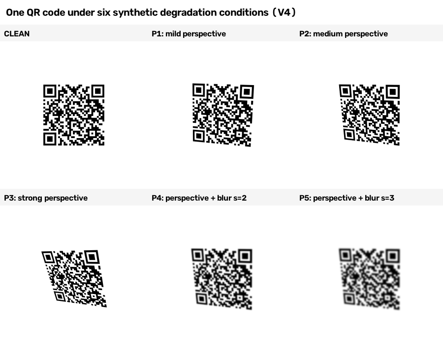
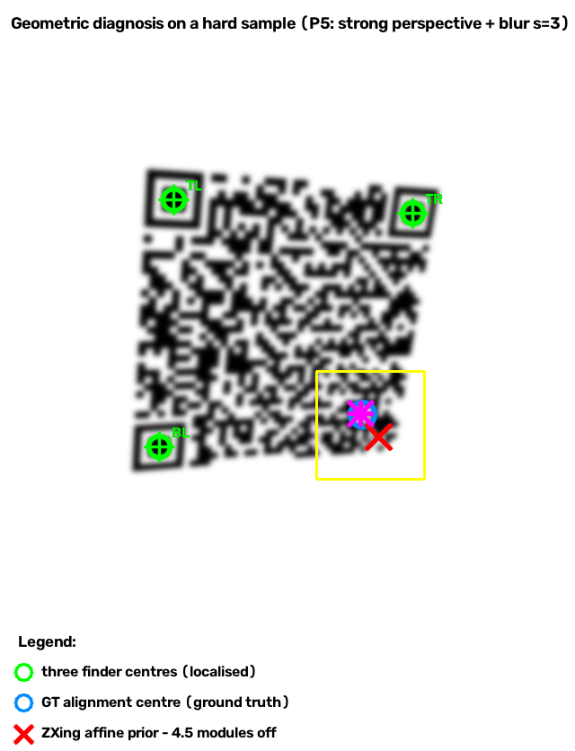
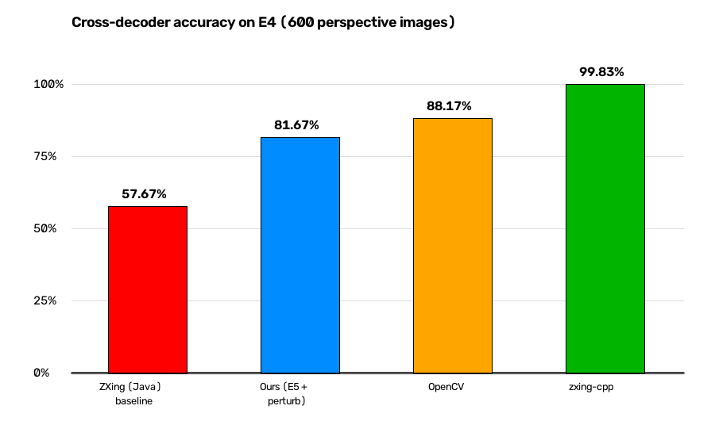

# QR-Degraded-Diagnosis

**White-box, zero-training diagnosis of *why* QR decoders fail — plus a reusable degraded-QR benchmark with ground truth.**

This is **not "yet another decoder"**. It is a *diagnosis framework*: it explains, in exact modules, where and why a QR decoder's geometry breaks down under perspective distortion + blur, and routes decoding decisions accordingly. Fully interpretable. Zero training data. Single CPU.

---

## What it looks like (60-second overview)

**The degradation spectrum** — one QR code, from clean to strong perspective + heavy blur:



**The core idea: white-box geometric diagnosis.** Under perspective, ZXing's native affine prior places the alignment center **4.5 modules off** (red ✕); our closed-form projective prior corrects it to **0.4 modules** (magenta ★, nearly on top of the blue ground-truth circle). *This* — explaining a failure in exact modules — is something black-box decoders cannot do:



---

## Why this matters (what black-box decoders don't give you)

| Capability | zxing-cpp / OpenCV | This project |
|---|---|---|
| Explain *why* a decode fails | ✗ black box | ✓ white-box, per-geometry-layer |
| Quantify localization error in modules | ✗ | ✓ (e.g. "4.5 modules off") |
| Training data / GPU needed | — (hand-tuned heuristics) | **zero — closed-form, single CPU** |
| Explicit latency ↔ accuracy cost model | implicit | ✓ measured (+1.4% ↔ +41.6%) |
| Reusable ground-truth benchmark | ✗ | ✓ (1600 images + homography GT) |
| Decompose error into cause layers | ✗ | ✓ (P0 ≈ ε_struct + ε_true) |

**The point:** accuracy is not the battleground here. zxing-cpp and OpenCV decode *more* images, but they are black boxes — ask them *why* an image failed and you get nothing. This project answers that question, in numbers, at the geometry level, with no training. That diagnosis has independent value: quality grading, adaptive resource allocation, teaching exactly how ZXing fails.

---

## What the project does

### 1. Root-cause diagnosis

ZXing's affine prior for the bottom-right alignment pattern conflates two error sources under perspective:

```
P0 ≈ ε_struct + ε_true
     ε_struct ≈ 1.86–3.77 modules   (structural error of the affine prior)
     ε_true   ≈ 0.03–0.09 modules   (true localization error)
```

This decomposition is the key insight: it explains *why* affine-P0 gating worsens ZXing on perspective data (346 → 161) despite helping on near-axis blur (692 → 900).

### 2. The method (E5): zero-training, interpretable fix

- **Projective prior `p_proj`** — closed-form reconstruction of the alignment center (module `D−6.5`) from three finder centers + local directional module sizes. No corner extraction, no SVD, no training. Error **0.0 modules** on the synthetic perspective set (affine prior: median 2.88).
- **`P0_proj` gate** — detects alignment-pattern mislocks using `p_proj`.
- **Projective fallback** — uses `p_proj` as the 4th point when no alignment pattern is found.
- **Checksum-triggered perturbation retry** — re-samples the 4th point with sub-module offsets *only when decoding fails* (zero cost on successes).

**Result:** E4 490/600 = 81.67% (matching the oracle upper bound), E2 900/1000 with zero regression; vs original ZXing: +144 recovered, 0 worsened.

### 3. Ablation & cost model

| Component removed (E4) | Loss |
|---|---|
| Projective fallback | 94 images |
| `P0_proj` gate | 37 images |
| Perturbation retry | 28 images |
| Search guidance | 0 images |

Latency: **+1.4%** overhead for **+41.6%** relative decode-rate gain; projective prior ≈ 6 µs; perturbation only on failures (~0.7 ms). Cost is allocated exactly where it pays off.

---

## The honest part: cross-decoder reality check

We also benchmarked the *same* images against other decoders — and report the result plainly, because it matters:



| Decoder | Correct (E4, 600) | Nature |
|---|---|---|
| ZXing Java 3.5.4 (baseline) | 57.67% | the decoder being diagnosed |
| This project (E5 + perturbation) | 81.67% | in-framework fix |
| OpenCV 5.0 | 88.17% | independent implementation |
| zxing-cpp 3.1.1 | 99.83% | ZXing's rewritten C++ port |

**What this means:** the "alignment-pattern mislock" problem is largely a ZXing-Java-specific architectural weakness (single global perspective transform + affine prior), which zxing-cpp sidesteps via `TraceLine` edge-intersection + sub-pixel refinement + multi-binarizer fallback. This is exactly the "guard against ZXing-bug-fix criticism" flagged at inception — now confirmed by evidence.

**Why the project is still valuable despite this:** the *diagnosis* transfers and the *benchmark* transfers. Knowing precisely how and where geometry fails is useful even when a faster black-box decoder happens to succeed — and the 1600-image ground-truth benchmark is reusable by anyone studying degraded QR decoding.

---

## Repository layout

```
├── code/
│   ├── detector/        # E5 patch on ZXing Java's Detector.java (E5_ADAPTIVE + perturbation)
│   ├── analysis/        # ablation, latency, gap-diagnosis, adaptive-decoder analysis scripts
│   └── cross_decoder/   # OpenCV & zxing-cpp batch decoders + three-way comparison
├── data/
│   └── generate/        # scripts to regenerate the synthetic datasets (with GT homography)
├── results/             # per-condition / ablation / latency summary CSVs & JSONs
├── docs/
│   ├── images/             # README gallery figures
│   ├── direction_review.md   # full experiment summary & termination assessment
│   └── paper_draft.md        # paper draft (methods + synthetic experiments, data-verified)
└── README.md
```

## Datasets

Two synthetic degraded-QR sets with ground-truth homography (alignment-center + finder positions per image):

- **E2** — near-axis Gaussian blur, 1000 images, σ ∈ {0 … 4.0}.
- **E4** — perspective distortion, 600 images across 6 conditions (clean / mild / medium / strong perspective, plus two joint perspective+blur levels).

Regenerate via `data/generate/*.py` (requires the QR generator + `pyzbar`-free pipeline; see `docs/`). Raw PNGs are ~79 MB and are therefore not committed — scripts reproduce them deterministically.

## Reproduce the key numbers

```bash
# 1. build the patched ZXing (Java)
mvn -f zxing-core-e2/pom.xml clean compile

# 2. run E5_ADAPTIVE on E4
java -Dzxing.e2.geometryMode=E5_ADAPTIVE -Dzxing.e2.thresholdModules=2.0 \
     -cp zxing-core-e2/target/classes edu.wuyi.qr.BatchDecodeE2 \
     data/e4_perspective_v1_1/images records/e4_e5.csv

# 3. cross-decoder benchmark (OpenCV / zxing-cpp)
python code/cross_decoder/run_e4_opencv_v1_1.py
python code/cross_decoder/run_e4_zxingcpp_v1_1.py

# 4. analysis
python code/analysis/analyze_e5_ablation_v1_1.py
python code/analysis/analyze_e5_latency_v1_1.py
```

## License

See `LICENSE`. The ZXing-derived detector code retains its Apache-2.0 lineage.
